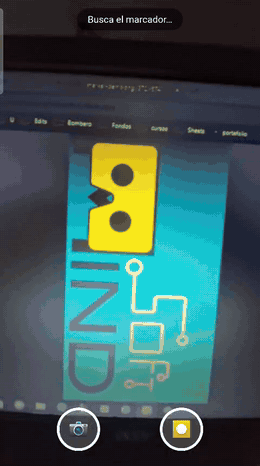
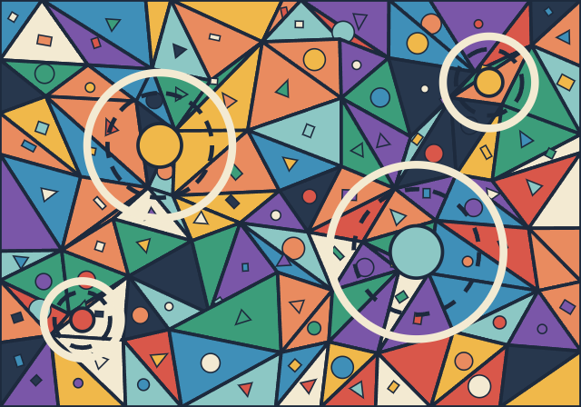

# webar-mapping-template

A ready-to-use **WebAR template**: point a phone camera at an image (the *marker*) and content appears on top of it (image, video, 3D model or sound), with buttons to **take photos and record videos with the AR baked in**. No app to install, no build step; it runs in the browser and deploys free on GitHub Pages.

> Made for **AR mapping**: projected or printed markers that trigger a scene on each visitor's phone.

*Español: [README.md](README.md)*

<p align="center"></p>

<p align="center"><b><a href="https://nach2212.github.io/webar-mapping-template/?lang=en">▶ Try the live demo</a></b> (open it on your phone and point at <a href="targets/marker-demo.png"><code>targets/marker-demo.png</code></a>)</p>

## Try it in 2 minutes

1. Open the [demo](https://nach2212.github.io/webar-mapping-template/?lang=en) on your phone and tap **Enable camera**.
2. Open [`targets/marker-demo.png`](targets/marker-demo.png) on another screen (or print it) and point your phone at it. A spinning cyan circle should appear.
3. Use 📷 to take a photo and ⏺ to record a video; when it finishes you can share or download it.

If something fails, the app tells you what happened. More help in [Troubleshooting](docs/troubleshooting.en.md).

## Your first mapping

The step-by-step guide is **[docs/first-mapping.en.md](docs/first-mapping.en.md)**: from copying the template to setting it up with a projector. In short:

1. Copy this repo (*Fork*) and enable GitHub Pages.
2. Open `compile.html`, upload your marker images and save the downloaded file as `targets/targets.mind`.
3. Put your images, videos, models and sounds in `assets/`.
4. Edit `config.js`: one block per marker, in the same order the compiler listed the images.

```js
targets: [
  {
    name: 'portal',
    content: [
      { type: 'video', src: 'assets/whale.mp4',   width: 1, position: [0, 0, 0.01], sound: true },
      { type: 'image', src: 'assets/sparkle.png', width: 0.4, position: [0, 0, 0.05], spin: true }
    ]
  }
]
```

## Content types

| `type` | Shows | Options |
|---|---|---|
| `image` | An image (transparent PNG works) | `src`, `width`, `position`, `spin` |
| `video` | A video on the marker | `src`, `width`, `position`, `loop`, `sound` |
| `model` | A `.glb`/`.gltf` 3D model with its animations | `src`, `scale`, `position`, `rotation`, `spin` |
| `audio` | Sound while the marker is in view | `src`, `loop`, `volume` |

- **Units:** `1` equals the marker's width. `width: 0.5` is half of it.
- **`position: [x, y, z]`:** `x` to the right, `y` up, `z` towards you (out of the marker). The marker's centre is `[0, 0, 0]`.
- **`rotation`** is in radians; **`spin: true`** makes the content rotate.
- **`sound: true`** makes a video audible (videos are silent by default so they can start on their own).
- Sound from `audio` items and from videos with `sound: true` **is recorded into the videos** visitors capture.

A marker can have several items at once. If you define several markers, the camera tracks **one at a time** (whichever is in view).

There is a test cube at `assets/demo-cube.glb`.

## config.js options

| Option | What it does | Default |
|---|---|---|
| `targetsFile` | Path to the `.mind` file with your markers | `'targets/targets.mind'` |
| `title`, `intro` | Start screen texts | generic texts |
| `lang` | Language of buttons and messages: `'auto'`, `'es'` or `'en'` | `'auto'` |
| `watermark` | Watermark on photos and videos (`''` removes it) | — |
| `maxVideoSeconds` | Maximum length of each video | `30` |
| `recordAudio` | Include content sound in recorded videos | `true` |
| `quality` | `'auto'`, `'high'` or `'low'` (see [performance](docs/troubleshooting.en.md#it-is-slow-or-the-phone-gets-hot)) | `'auto'` |
| `targets` | Your markers and their content | — |

If you make a mistake while editing (a misspelled type, a missing file, more markers than you compiled), the app shows it on screen instead of staying black.

## Example markers

[`examples/`](examples/) contains three original markers designed for mapping, already compiled:

| Gears | Constellation | Mosaic |
|---|---|---|
|  |  |  |

Try them with **[the examples demo](https://nach2212.github.io/webar-mapping-template/?config=examples/config.js&lang=en)** (`?config=examples/config.js`) by pointing at any of the three images. You can use them as they are in your project: there is an `.svg` version to print or project at any size.

## Useful URL parameters

| Parameter | What it does |
|---|---|
| `?debug` | Shows version, detected marker, camera, FPS and quality on screen (useful when reporting problems) |
| `?config=folder/config.js` | Uses another config file: several experiences on one site |
| `?wm=My%20Text` | Changes the watermark (`?wm=` removes it) |
| `?lang=en` | Forces the language (`es` or `en`) |
| `?q=low` | Forces the quality (`low` or `high`) |
| `?cf=0.0001` | MindAR's `filterMinCF` (lower = smoother) |
| `?beta=0.001` | MindAR's `filterBeta` (higher = more responsive, but jittery) |

## Compatibility

It needs a browser with *import maps*: **Chrome 89+**, **Safari / iOS 16.4+** or **Firefox 108+**, and the page must be served over **https**.

| Feature | Android · Chrome | iPhone · Safari | Desktop Chrome |
|---|---|---|---|
| Open camera and track the marker | ✅ | ❓ | 🧪 |
| `image` content | ✅ | ❓ | 🧪 |
| `video`, `model`, `audio` content | ❓ | ❓ | 🧪 |
| Photo with AR | ❓ | ❓ | 🧪 |
| Video with AR | ❓ | ❓ | 🧪 |
| Sound inside the recorded video | ❓ | ❓ | 🧪 |
| Share button | ❓ | ❓ | — (Download is used) |

- ✅ tested on a real phone · 🧪 tested only by automated tests (desktop Chrome with a simulated camera) · ❓ not yet tested on a real device.
- **Do you own one of those phones?** A [device report](https://github.com/Nach2212/webar-mapping-template/issues/new?template=device-report.md) helps a lot and takes 2 minutes.

Good to know (according to each browser's documentation):

- **Recorded video format:** MP4 where the browser allows it (always on Safari; recent Chrome) and WebM elsewhere.
- **iPhone:** the volume of `audio` items cannot be changed (`volume` is ignored, it plays at full volume). Use MP4 (H.264) for your videos; WebM does not work on older iOS versions.
- **In-app browsers** (Instagram, Facebook, TikTok): many do not give camera access. The app says so and asks to open the link in Chrome or Safari.
- **Dependencies:** three.js 0.160 and MindAR 1.2.5 load from a CDN with pinned versions. Do not raise three beyond 0.161 (MindAR 1.2.5 stops loading).

## Tips for good markers

- Lots of detail, high contrast and unique shapes. Avoid large flat areas and repeated patterns.
- **If you are going to project it:** a projector's black looks grey under ambient light, so use mid tones and strong edges.
- Test printed vs projected, and at 0°, 30° and 45°.
- Each detailed marker adds about 0.5 MB to the `.mind` file: use only the ones you need.

## Troubleshooting

The most common cases (full list in [docs/troubleshooting.en.md](docs/troubleshooting.en.md)):

| Symptom | What to check |
|---|---|
| "Camera permission is blocked" | The site's permission in the browser (padlock next to the address) |
| The camera opens but nothing appears | Light, reflections and distance; that the marker is the one you compiled; try `?debug` |
| "Marker file … was not found" | That `targets/targets.mind` exists and `targetsFile` has the right path |
| The button stays on "Loading…" | Internet connection; a very old browser (iPhone: iOS 16.4 or later) |
| Content appears rotated or shifted | `position` / `rotation` in `config.js`; that the marker is not rotated compared to the compiled one |

## Publish for free (GitHub Pages)

1. Push everything to a repo.
2. *Settings → Pages → Deploy from a branch → `main` / root*.
3. Open `https://YOUR-USER.github.io/YOUR-REPO/`. **https is required** for camera access (Pages provides it).

## Run it on your computer and run the tests

There is nothing to install or build. Serve the folder with any static server:

```bash
python3 -m http.server 8000
```

Open `http://localhost:8000` (on `localhost` the camera works without https). To test from a phone you need https: publish to Pages or use a tunnel (`cloudflared`, `ngrok`).

Tests (optional, for people changing the code):

| What | How | Needs |
|---|---|---|
| Unit tests + app load check | Open `http://localhost:8000/tests/` | Just the browser |
| The same, from the terminal | `node tests/run-node.mjs` and `node tests/check-site.mjs` | Node 22+ |
| End to end with a simulated camera | `node tests/e2e.mjs` | Node 22+ and Chrome |

The end-to-end tests show the marker to Chrome's fake camera and check detection, photo, video, recorded sound and every error message. They do not replace testing on a real phone.

## How it works

- [MindAR](https://github.com/hiukim/mind-ar-js) (MIT) for image tracking.
- [three.js](https://threejs.org/) to draw the content on the marker.
- Capture composites camera + 3D scene + watermark into a `<canvas>` and records it with `MediaRecorder`; sound is mixed in with Web Audio.

Structure:

- `config.js` — **the only file you edit**.
- `index.html`, `app.js` — screen, camera, tracking and messages.
- `content.js` — builds image / video / model / audio for each marker.
- `capture.js` — photo and video with AR and sound.
- `i18n.js` — Spanish and English strings. `utils.js` — validation and helpers.
- `compile.html` — in-browser marker compiler.
- `examples/` — example markers. `tests/`, `tools/` — tests and utilities (not needed to use the template).

## Credits and license

- Code: [MIT](LICENSE) © Ignacio Aguayo Pichún. Changes in [CHANGELOG.md](CHANGELOG.md); how to contribute in [CONTRIBUTING.md](CONTRIBUTING.md).
- The markers in `examples/` are original to this project (MIT).
- The `targets/marker-demo.png` marker and its `.mind` come from MindAR's official example (MIT license). Replace them with your own.
