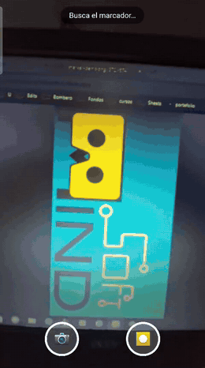

# webar-mapping-template

Plantilla **WebAR** lista para usar: apunta la cámara del celular a una imagen (marcador) y aparece contenido encima (imagen o video), con botones para **sacar fotos y grabar videos con el AR incluido**. Sin instalar apps, sin build, funciona en el navegador y se publica gratis en GitHub Pages.

> Pensada para **mapping AR**: marcadores proyectados o impresos que activan una escena en el celular de cada persona.

*English: [README.en.md](README.en.md) — a zero-build WebAR template (MindAR + three.js) with image tracking, image/video overlays and photo/video capture with AR baked in. Edit `config.js`, compile your markers, deploy to GitHub Pages.*

<p align="center"></p>

<p align="center"><b><a href="https://nach2212.github.io/webar-mapping-template/">▶ Probar la demo en vivo</a></b> (ábrela en tu celular y apunta a <code>targets/marker-demo.png</code>)</p>

## Probarlo en 2 minutos

1. Publica el repo en GitHub Pages (ver abajo).
2. Abre el link en tu celular y toca **Activar cámara**.
3. Apunta a `targets/marker-demo.png` (en otra pantalla o impresa). Debería aparecer un círculo cian girando.
   Si no pasa nada, agrega `?debug` al link y revisa la consola, o salta a la sección de abajo y compila tu propio marcador.

## Usar tus propios marcadores

1. Abre `compile.html` (con un servidor local o desde Pages), sube tus imágenes **en el orden que quieras** y descarga `targets.mind`.
2. Guarda ese archivo en `targets/targets.mind`.
3. Edita `config.js`: un bloque por marcador, en el mismo orden. Copia el `aspect` (alto/ancho) que te muestra el compilador.
4. Pon tus imágenes/videos en `assets/` y apunta a ellos con `src`.

```js
targets: [
  {
    name: 'portal',
    aspect: 0.5625,
    content: [
      { type: 'video', src: 'assets/ballena.mp4', width: 1, position: [0, 0, 0.01] },
      { type: 'image', src: 'assets/brillo.png',  width: 0.4, position: [0, 0, 0.05], spin: true }
    ]
  }
]
```

## Tipos de contenido

| `type` | Qué muestra | Opciones principales |
|---|---|---|
| `image` | Imagen (PNG con transparencia sirve) | `src`, `width`, `position`, `spin` |
| `video` | Video sobre el marcador | `src`, `width`, `position`, `loop` |
| `model` | Modelo 3D `.glb`/`.gltf` con sus animaciones | `src`, `scale`, `position`, `rotation`, `spin` |
| `audio` | Sonido al detectar el marcador (pausa al perderlo) | `src`, `loop`, `volume` |

Hay un cubo de prueba en `assets/demo-cube.glb`. Nota: el audio suena en el celular pero **no** queda grabado en los videos capturados (por ahora, ver issues).

## Publicar gratis (GitHub Pages)

1. Sube todo a un repo.
2. *Settings → Pages → Deploy from a branch → `main` / root*.
3. Abre `https://TU-USUARIO.github.io/TU-REPO/`. **Necesita https** para que el navegador deje usar la cámara (Pages ya lo trae).

Para probar local: `python3 -m http.server` y abre desde el celular con un túnel https (o directo en `localhost` en el computador).

## Parámetros útiles en la URL

| Parámetro | Para qué sirve |
|---|---|
| `?wm=Mi%20Texto` | Cambia la marca de agua (`?wm=` la quita) |
| `?debug` | Muestra en la consola cuándo se encuentra o se pierde el marcador |
| `?cf=0.0001` | `filterMinCF` de MindAR (menos = más suave) |
| `?beta=0.001` | `filterBeta` de MindAR (más = responde más rápido, pero tiembla) |

## Consejos para buenos marcadores

- Mucho detalle, alto contraste y formas únicas. Evita zonas planas grandes y patrones repetidos.
- **Si lo vas a proyectar**: el negro del proyector se ve gris con luz ambiente, así que usa tonos medios y bordes bien marcados.
- Prueba impreso vs proyectado, y a 0°, 30° y 45°. Prueba en Android (Chrome) y iPhone (Safari).

## Cómo funciona

- [MindAR](https://github.com/hiukim/mind-ar-js) (MIT) para el image tracking.
- [three.js](https://threejs.org/) para dibujar el contenido sobre el marcador.
- La captura compone cámara + escena 3D + marca de agua en un `<canvas>` y lo graba con `MediaRecorder`.

## Estructura

- `config.js` — lo único que editas.
- `content.js` — construye imagen / video / modelo / audio para cada marcador.
- `app.js` — cámara, tracking, captura de foto y video.
- `compile.html` — compilador de marcadores en el navegador.

## Créditos y licencia

- Código: [MIT](LICENSE) © Ignacio Aguayo Pichún.
- El marcador y el archivo `.mind` de demo vienen del ejemplo oficial de MindAR (licencia MIT). Cámbialos por los tuyos.
